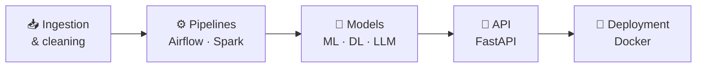

# Salaheddine Jalloul

### Machine Learning  Data and  AI Engineering

*I turn raw data into reliable AI systems, from the pipeline all the way to the API.*

Master's student in Big Data & Cloud Computing · Casablanca 🇲🇦

---

## 🧭 How I build

A model is only useful if the data feeding it is reliable, and an AI system is only worth something if it can be deployed. So I work across the **entire chain**:

---

## 🔬 My three playgrounds

### 🧠 Machine Learning
Supervised classification, Deep Learning and NLP: training, comparing and evaluating honestly, and analyzing bias rather than chasing a single score.

`Scikit-learn` `PyTorch` `RoBERTa`

### 🏗️ Data Engineering
Orchestrated ETL pipelines, large-scale processing, Lakehouse architecture and quality controls (consistency checks, deduplication) so that data can be trusted.

`Airflow` `Spark` `SQL` `PostgreSQL` `Lakehouse` `Metabase`

### 🤖 AI Engineering
Generative AI in real-world conditions: LLM agents, RAG, orchestration with LangGraph, all exposed through REST APIs and containerized.

`LangGraph` `LLM` `RAG` `FastAPI` `Docker`

---

## 🚀 Projects

<table>
<tr>
<td width="50%" valign="top">

### 💹 Financial Agent RAG
Financial analysis agent built on RAG.

- **7,149 documents** → **25,188 chunks** indexed
- Reliability metrics on ingestion
- **FastAPI** API, **LangGraph** orchestration
- Containerized with **Docker**

</td>
<td width="50%" valign="top">

### 🐦 Twitter Sentiment Analysis
NLP classification, from classic ML to RoBERTa.

- **77.34%** accuracy · **77.33%** macro-F1
- Bias and error analysis
- Interactive **Streamlit** interface

</td>
</tr>
<tr>
<td width="50%" valign="top">

### 🎓 UnivData
Data platform on academic output.

- **2,134 publications** · **718 profiles**
- **6 Airflow DAGs** orchestrating the data flows
- **Metabase** dashboards, quality controls

</td>
<td width="50%" valign="top">

### ☁️ Virtualization & Cloud
Infrastructure as Code: from a single VM to automated deployment.

- KVM/QEMU, Cloud-Init, Jinja2, Rocky Linux 9
- 3 VMs deployed from a template by a Python script
- [See the repository →](https://github.com/SALAHEDDIN47/virtualisation-cloud-computing)

</td>
</tr>
</table>

---

## 🧰 Toolbox

---

## 🌱 Currently

- Pushing my RAG agents toward greater reliability and evaluation
- Exploring Lakehouse architecture and agent orchestration with LangGraph
- Strengthening my DevOps foundations: Docker, CI/CD, cloud

---

### 📬 A Data, ML or AI project? Let's talk.

